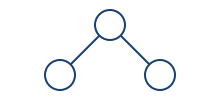

Practice
========

Code from a file
----------------

.. literalinclude:: ../assets/example.py
   :language: python
   :lines: 2-3

Download :download:`the source <../assets/example.py>`.

   A small tree, used as an image fixture.

Graphviz
--------

.. graphviz::
   :caption: A directed tree

   digraph tree { root -> left; root -> right; }

Return to :doc:`../concepts` or :ref:`worked-example`.
